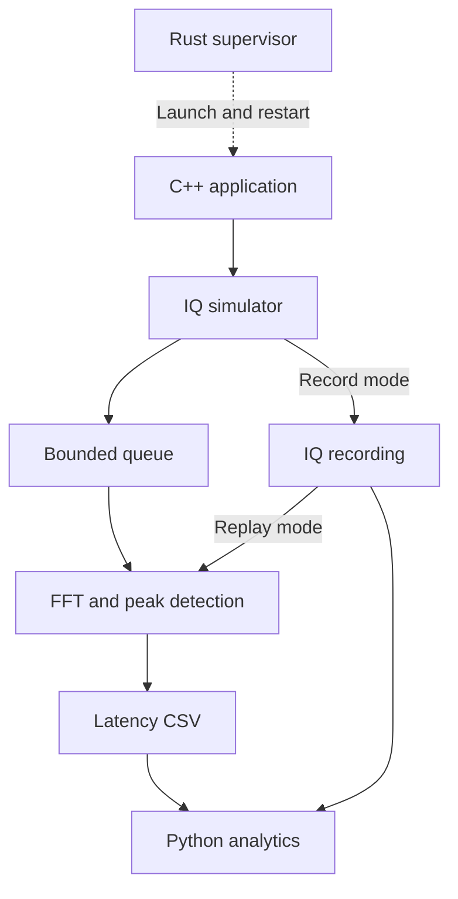

<div align="center">

# SDR & RF Processing Platform

A software-defined radio simulation with a C++20 DSP core, Rust process
supervision, and Python analytics. Explores signal processing, concurrent
buffering, and failure handling without radio hardware.

[](src/)
[](rust_supervisor/)
[](python/)
[](CMakeLists.txt)
[](Dockerfile)
[](LICENSE)

**[Read the technical paper](docs/sdr-technical-paper.pdf)** ·
**[LaTeX source](docs/sdr-technical-paper.tex)**

</div>

## Technical paper

**[Open the report in GitHub's scrollable PDF viewer](docs/sdr-technical-paper.pdf)** ·
[LaTeX source](docs/sdr-technical-paper.tex)

<details>
<summary><strong>Expand the full report preview</strong></summary>

### Design and Verification of an Instrumented Software-Defined Radio Processing Pipeline

**Tyree Franklin Jr.**  
Computer Science, Western Governors University

#### Abstract

This paper examines a software-defined radio processing
platform that combines a C++20 signal-processing core,
a Rust process supervisor, and Python analysis tools.
The architecture uses a bounded producer-consumer queue
and an iterative radix-2 fast Fourier transform to process
simulated in-phase and quadrature samples.
Reanalysis of 1,500 archived measurements gives a mean
processing latency of 0.111014 ms and an interpolated
99th percentile of 0.167423 ms. Every logged block identifies
frequency bin 20, consistent with the intended 5 kHz input.
Source inspection identifies simulator interface and
serialization defects that prevent these historical results
from validating the reviewed revision.
The analysis defines the measurement boundary, examines
backpressure and process restart behavior, and specifies
acceptance tests for a reproducible baseline.

**Keywords:** software-defined radio, digital signal processing, concurrency, performance measurement, software verification

#### Introduction

A software-defined radio (SDR) application must coordinate
sample production, buffering, numerical computation, and
output. Transform performance is one part of this problem.
Queue delays, data representation, scheduling, and failure
handling also affect processing correctness and timing.

The TeleComms--Software-Defined-Comms repository implements
a hardware-independent platform for studying these
interactions ([repository](https://github.com/tyreefranklinjr/TeleComms--Software-Defined-Comms)). C++ provides the processing path,
Rust manages the child process, and Python summarizes
recorded measurements.

This paper presents an engineering case study of the
platform's architecture, archived processing measurements,
and verification requirements. It examines which conclusions
the available evidence supports and identifies the work
needed to reproduce the results from a consistent source
baseline.

The analysis makes three contributions:

1. A description of the implementation's computational,
buffering, and supervision behavior.
1. A recalculation of the archived latency statistics
with an explicit measurement boundary.
1. Acceptance criteria addressing numerical correctness,
recording fidelity, concurrency, and recovery.

#### Evidence and Method

The reviewed repository revision is:
`4c38af8eea230fa8f93ecf38ad5f0bb63f0bbbf5`

The review covers the C++ source, Rust supervisor, Python
analytics, CMake configuration, FFT test, and committed
metrics CSV. The repository was accessed on October 20, 2026.

Source inspection and archived measurements provide distinct
forms of evidence. Statements about control flow and
representation follow from the inspected code. Numerical
results were recalculated from the committed CSV.
The acceptance tests in the Verification Plan section
are proposed work.

No C++ or Rust build, hardware experiment, or fault-injection
campaign was executed for this analysis. The binary IQ
recording was not numerically evaluated. The archived
measurements are therefore treated as historical artifacts,
rather than a reproduction of the reviewed revision.

#### Architecture

##### Processing Path

A producer generates blocks of in-phase and quadrature (IQ)
samples and submits them to a bounded queue. A consumer
removes each block, converts its samples to the FFT
representation, computes the magnitude spectrum, and
selects the largest bin.

| Parameter | Value |
|---|---:|
| Nominal sample rate | 1,024,000 samples/s |
| Tone frequency | 5,000 Hz |
| Transform length | 4,096 samples |
| Queue capacity | 16 blocks |
| Run length | 1,500 blocks |
| Noise amplitude parameter | 0.3 |

The queue uses a mutex, two condition variables, and a
`std::deque`. A producer waits when the queue is full.
A consumer waits when it is empty. Both waits recheck their
conditions after waking. Shutdown wakes waiting threads
and allows the consumer to drain remaining items.

Backpressure bounds queue occupancy by slowing the producer.
This behavior accommodates a cooperative simulator.
A physical acquisition device may continue producing samples
while the application is blocked, requiring explicit overrun
detection and a defined loss policy.

The queue copies sample vectors on insertion and removal.
These copies require $O(N)$ work per operation for a block
of $N$ samples. Queue payload storage is $O(QN)$ for
capacity $Q$. The latency recorder separately retains
one observation per block, so its storage grows with run
length.

##### Timing Model

The nominal block period is

$

T_b=\frac{N}{f_s}
=\frac{4096}{1{,}024{,}000}
=4\ \mathrm{ms}.

$

The producer generates and enqueues a block before sleeping
for $T_b$. Generation, copying, blocking, and scheduler
delay add to the interval between releases. The configured
sample rate describes the signal model; the implementation
does not establish that rate as a sustained wall-clock
acquisition rate.

A periodic acquisition model would require absolute release
times, recorded release jitter, and a policy for missed
releases.

##### Process Supervision

The Rust supervisor launches the C++ executable using Tokio.
A nonzero exit or an injected termination enters a retry
path with a one-second delay. Failure injection is selected
with a configured probability of 30%, with a requested
termination delay between 50 and 299 ms.

Recovery time includes the retry delay, process startup,
initialization, and the time required to produce valid
output. The configured delay alone does not measure
recovery.

The constant `MAX_RESTARTS` is five, but the counter
is incremented before the limit check. Under repeated child
failures, this permits five launches and four relaunches.
The final status message can report six attempts.
The implementation needs a consistent definition of
whether the limit counts launches or retries.

#### Signal Processing

##### Intended Input

The intended complex signal is

$

x[n]=e^{j2\pi f_0n/f_s}+\eta_I[n]+j\eta_Q[n].

$

The noise components are generated by scaling
`rand()` to a bounded interval. They do not follow
a Gaussian noise model.

If the components are modeled as independent uniform
variables on $[-a,a]$, their combined expected noise
power is $2a^2/3$. With a unit-magnitude tone and
$a=0.3$, the analytical signal-to-noise ratio is

$

10\log_{10}\left(\frac{1}{2a^2/3}\right)
\approx12.22\ \mathrm{dB}.

$

This value describes the assumed model. It was not measured
from the archived recording. The simulator interface must
also be reconciled with its callers before this model can
be attributed to execution of the reviewed source.

##### Transform and Peak Selection

The implementation computes the unnormalized discrete
Fourier transform:

$

X[k]=\sum_{n=0}^{N-1}x[n]e^{-j2\pi kn/N}.

$

An iterative radix-2 algorithm performs bit reversal followed
by butterfly stages. The transform requires
$O(N\log_2N)$ arithmetic work. Magnitude calculation
and peak selection each require $O(N)$ work.

For the intended configuration,

$

\Delta f=\frac{f_s}{N}=250\ \mathrm{Hz},
\qquad
k_0=\frac{f_0}{\Delta f}=20.

$

An ideal unit-amplitude complex tone at bin 20 produces
an unnormalized magnitude of 4,096 at that bin.
This magnitude is not calibrated RF power or power spectral
density.

No window is applied. A bin-centered tone is therefore
a favorable test case. Off-bin tones, negative frequencies,
multiple tones, and varying amplitudes are needed to
evaluate broader spectral behavior.

#### Performance Analysis

##### Measurement Boundary

Live-mode timing starts after queue removal. It includes
sample conversion, spectrum computation, and peak search.
The spectrum function takes its argument by value, so the
timed region includes that argument copy.

The measurement excludes sample generation, queue waiting,
queue removal copies, CSV output, and console output.
It measures processing latency within this boundary.

For observation $i$,

$

L_i=t_i^{\mathrm{stop}}-t_i^{\mathrm{start}}.

$

End-to-end latency would require an additional timestamp
at sample acquisition or block creation.

##### Archived Dataset

The CSV contains 1,500 observations with unique, contiguous
block identifiers from 0 through 1,499. All observations
were retained, with no warm-up exclusion or outlier removal.

The mean is

$

\overline{L}=\frac{1}{M}\sum_{i=1}^{M}L_i.

$

For sorted, zero-indexed observations, the interpolated
percentile uses position $h=p(M-1)$. Let
$j=\lfloor h\rfloor$. Then

$

q_p=L_{(j)}+(h-j)
\left(L_{(\lceil h\rceil)}-L_{(j)}\right).

$

The C++ summary instead selects the observation at index
$\lfloor0.99(M-1)\rfloor$.
The results table reports both conventions.

| Statistic | Value |
|---|---:|
| Observation count | 1,500 |
| Mean | 0.111014 ms |
| Median | 0.104865 ms |
| Interpolated p99 | 0.167423 ms |
| C++ convention p99 | 0.167409 ms |
| Minimum | 0.088159 ms |
| Maximum | 0.501117 ms |
| Peak bin in every row | 20 |
| Observations above 4 ms | 0 |

The interpolated p99 is approximately 4.19% of the nominal
block period. The maximum is approximately 12.53%.
These values indicate processing-time margin in the archived
sample, within the stated measurement boundary.

They do not establish a worst-case execution bound.
The dataset lacks acquisition timestamps, hardware details,
scheduler information, and an identified producing commit.

The peak bin is 20 in every row, consistent with the intended
5 kHz tone. This checks the recorded peak outputs against
the nominal configuration. It does not verify every complex
transform value.

The blocks represent 6,144,000 samples, equivalent to six
seconds of modeled signal time. Elapsed runtime was not
established.

#### Source Findings

##### Simulator Interface

The simulator header declares global types
`IQSim` and `IQSample`.
The pipeline expects `IQSimulator`, while the entry
point references `sdr::IQSimulator` and
`sdr::IQSample`. Matching declarations are absent
from the inspected source.

The simulator constructor declares frequency before sample
rate, while callers pass sample rate before frequency.
Correcting the class name alone would leave the argument
contract inconsistent.

These findings prevent treating the archived CSV as
evidence that the reviewed revision builds and runs
successfully. They follow from source inspection rather
than an executed compiler.

##### Recording Representation

IQ sample fields are declared as `double`.
The recorder writes `sizeof(float)` bytes from each
field's address. This copies part of a double representation
without numerically converting the value to float32.

The reader similarly writes float-sized byte sequences
into double fields. Python interprets the recording as
float32. The components therefore lack a consistent
numerical serialization contract.

The repair should use explicit float32 conversions and
float32 read temporaries. The format also needs a defined
byte order, sample rate, version, and malformed-input
policy.

##### FFT Input Length

The FFT assumes a power-of-two length without checking it.
Replay can return a partial final block. An unsupported
length can violate butterfly indexing assumptions and
lead to out-of-bounds access.

Replay must reject unsupported lengths or apply a documented
padding policy before calling the transform.

##### Delivery and Recovery

The consumer increments the delivered counter, but the
inspected pipeline does not invoke the dropped-block
counter. The dashboard displays a literal zero for dropped
blocks.

Contiguous CSV identifiers establish completeness of the
logged range. They do not measure upstream sample loss.
Delivery verification requires separate counts for received,
accepted, processed, rejected, and pending blocks.

The supervisor does not restore input offsets or checkpoints.
Its ordinary waiting path also has no progress timeout
for a stalled child. File-open errors in record and replay
modes can return without a nonzero process exit, obscuring
failure from the supervisor.

##### Test Coverage and Provenance

The supplied FFT test checks the positive-frequency peak
of a 1,024-point real cosine at bin 32. It provides a basic
correctness check but does not cover numerical error,
recording fidelity, queue shutdown, or recovery.

The README describes a CI directory that is absent from
the reviewed tree. CI execution is not established by this
snapshot. The CSV also lacks compiler, CPU, operating-system,
seed, and producer-revision metadata.

#### Verification Plan

The following acceptance criteria address the source
findings and measurement gaps. These tests have not been
executed as part of this analysis.

##### Build Reproduction

After interface corrections, a clean checkout shall build
and pass its CMake tests. Each benchmark shall record the
commit, compiler, flags, dependency versions, operating
system, CPU, command, seed, and output hashes.

##### Numerical Correctness

Test lengths 64, 256, 1,024, and 4,096 against an independent
double-precision reference. Inputs shall include an impulse,
DC, positive and negative complex tones, off-bin tones,
and seeded random samples.

For nonzero reference output, the proposed tolerance is

$

\frac{\|X_{\mathrm{test}}-X_{\mathrm{ref}}\|_2}
{\|X_{\mathrm{ref}}\|_2}\leq10^{-4}.

$

Zero input shall be tested separately. Unsupported lengths
shall be rejected before transform indexing.

##### Recording Fidelity

Known finite values shall survive recording and replay
with values equal to the specified float32 conversion.
C++ and Python shall decode identical fixtures.

Tests shall cover empty files, truncated sample pairs,
invalid metadata, and I/O failure. Operational failures
shall produce nonzero process exit codes.

##### Queue Behavior

Tests shall confirm bounded occupancy, ordered processing,
and exactly-once handling of accepted blocks during normal
completion. Shutdown shall wake a producer blocked on a full
queue and a consumer blocked on an empty queue.
Zero capacity shall be rejected.

At normal completion,

$

B_{\mathrm{accepted}}=B_{\mathrm{processed}}.

$

Failure cases shall additionally account for discarded
and pending blocks.

##### Timing and Recovery

Following correctness verification, collect at least ten
independently launched runs per configuration, each with
at least 15,000 blocks. Declare the warm-up policy and
retain the raw observations.

Measure processing latency, queue residence, end-to-end
latency, release jitter, occupancy, and deadline misses.
Include nominal load, CPU contention, and deliberate
consumer overload.

A proposed nominal target is p99 processing latency below
4 ms. End-to-end deadline behavior shall be evaluated
separately using acquisition or block-creation timestamps.

Recovery tests shall deterministically exercise normal
exit, nonzero exit, launch failure, forced termination,
and stalled execution. Measure recovery from fault
occurrence to the first valid output of the replacement
process. Verify exact launch counts at retry exhaustion.

#### Conclusion

The platform combines numerical processing, concurrent
buffering, process supervision, and offline analysis in
a compact SDR codebase. Its archived data show
0.111014 ms mean processing latency and 0.167423 ms p99
latency, with consistent detection of the intended tone bin.

The reviewed source requires corrections to simulator
interfaces and IQ serialization before those measurements
can be reproduced from the inspected revision.
The proposed acceptance tests provide a basis for verifying
the corrected implementation and extending its evaluation
to hardware acquisition.

##### Development disclosure

The repository identifies AI assistance in the FFT test and Python analytics. AI assistance was also used in preparing the manuscript and recalculating the archived statistics.

##### Reference

Tyree Franklin Jr., [TeleComms--Software-Defined-Comms, reviewed revision](https://github.com/tyreefranklinjr/TeleComms--Software-Defined-Comms/tree/4c38af8eea230fa8f93ecf38ad5f0bb63f0bbbf5), accessed October 20, 2026.

</details>


<p align="center">
  
</p>

<p align="center"><sub>Historical dashboard generated from the committed sample artifacts. See measurement scope and implementation status below.</sub></p>

## Overview

The platform models the software data path of an SDR receiver. A producer
generates complex in-phase and quadrature (IQ) samples. A consumer processes
blocks through a radix-2 fast Fourier transform (FFT) and identifies the
strongest frequency bin.

A bounded queue coordinates the threads and applies backpressure when the
consumer falls behind. A Rust supervisor launches the processing application
and exercises restart behavior through randomized process termination.
Python scripts summarize latency measurements and plot recorded samples.

The technical paper documents the architecture, archived measurements,
source findings, and acceptance criteria for numerical correctness,
recording fidelity, queue behavior, and recovery.

## Architecture



Live, record, and replay are separate application modes. Record mode writes
simulated samples directly to a file; replay mode reads a file and processes
its blocks without the live producer-consumer queue.

| Component | Implementation |
|---|---|
| Signal generation | Complex tone with bounded pseudorandom noise |
| Concurrent processing | Producer and consumer threads, mutex, condition variables, bounded queue |
| Frequency analysis | Iterative radix-2 FFT, magnitude spectrum, peak-bin search |
| Instrumentation | Per-block processing latency and CSV output |
| Process supervision | Tokio child-process management, delayed retries, randomized failure injection |
| Offline analysis | NumPy statistics and Matplotlib plots |

## Archived performance

Recalculated from [samples/metrics.csv](samples/metrics.csv), which contains
1,500 observations with contiguous block identifiers from 0 through 1,499.

The intended configuration uses 4,096 samples per block, a nominal sample
rate of 1.024 MS/s, and a 5 kHz tone.

| Metric | Result |
|---|---:|
| Mean processing latency | 0.111014 ms |
| Median processing latency | 0.104865 ms |
| p99 processing latency, interpolated | 0.167423 ms |
| Maximum observed processing latency | 0.501117 ms |
| Peak frequency bin | 20 in all 1,500 rows |
| Nominal frequency-bin spacing | 250 Hz |

Timing covers sample conversion, spectrum computation, and peak search.
It excludes sample generation, queue waiting, queue removal copies, and
CSV or console output. These are processing measurements, not end-to-end
latency or a worst-case execution bound.

The 4 ms nominal block period follows from the configured sample rate.
The producer sleeps after generation and enqueueing, so that configuration
does not establish a sustained wall-clock acquisition rate of 1.024 MS/s.

The CSV does not identify its producing commit or machine configuration.
These historical results have not been reproduced from the current source.

## Implementation status

Source inspection identified several issues that require correction before
a fresh build and record/replay validation:

- Simulator names and namespaces differ between declarations and callers.
  Constructor parameter order also differs.
- IQ fields use `double`, while recording and playback transfer float-sized
  byte sequences without numerical conversion.
- Replay can pass a partial block to an FFT that assumes a power-of-two length.

Delivery and recovery also need additional verification. The live pipeline
does not invoke its dropped-block counter, and the dashboard displays a
fixed zero for dropped blocks. Queue backpressure does not establish lossless
hardware acquisition. Process relaunch does not restore processing state
or detect a child that remains alive but stops making progress.

See the [technical paper](docs/sdr-technical-paper.pdf) for the full analysis
and proposed acceptance tests.

## Build and run

The commands below describe the application workflow. Resolve the source
issues above before using them to establish a new benchmark baseline.

Run from the repository root unless a command explicitly changes directories.

### C++ core

Requires CMake 3.16 or newer and a compiler supporting C++20. The current
simulator header uses a GNU-specific include.

```bash
cmake -S . -B build -DCMAKE_BUILD_TYPE=Release
cmake --build build
ctest --test-dir build --output-on-failure

# Process simulated samples and write per-block measurements.
./build/sdr_platform live metrics.csv

# Record simulated samples, then process the recording.
./build/sdr_platform record capture.iq
./build/sdr_platform replay capture.iq
```

The included FFT test checks the peak bin of a known real-valued tone.
Broader numerical and integration tests are specified in the paper.

### Rust supervisor

The supervisor resolves the C++ executable relative to its working directory,
so run it from `rust_supervisor/`.

```bash
cd rust_supervisor
cargo build --release
./target/release/sdr_supervisor live
```

Randomized failure injection is enabled in the current implementation.
The supervisor may intentionally terminate the child during a run.

### Python analytics

Run from the repository root:

```bash
python3 -m pip install -r python/requirements.txt

# Regenerate the historical dashboard from committed artifacts.
python3 python/generate_report.py samples/metrics.csv samples/capture.iq

# Inspect an IQ recording.
python3 python/analyze_iq.py samples/capture.iq 1024000
```

The IQ plots interpret the file as interleaved float32 values. Plot generation
alone does not verify recording fidelity; the serialization issue above
must be resolved and tested.

### Docker

The repository includes a Docker build definition. Building the container
also depends on correcting the C++ source issues.

```bash
docker build -t sdr_platform .
docker run --rm sdr_platform live
```

## Project structure

```text
src/                    C++ simulator, queue, FFT, metrics, and IQ file handling
tests/                  FFT peak-bin correctness check
rust_supervisor/        Tokio process supervisor and failure injection
python/                 Measurement analysis and plotting
samples/                Archived latency CSV and IQ recording
assets/                 Generated dashboard
docs/                   Technical paper in PDF and LaTeX formats
CMakeLists.txt          C++ build and test configuration
Dockerfile              Container build definition
flake.nix               Nix development environment definition
```

## Development notes

AI assistance (Claude) was used to help develop the test suite (`tests/`)
and the Python analytics and charting scripts (`python/`). The C++ DSP
pipeline and Rust supervisor are original implementation work.

## License

MIT. See [LICENSE](LICENSE).
