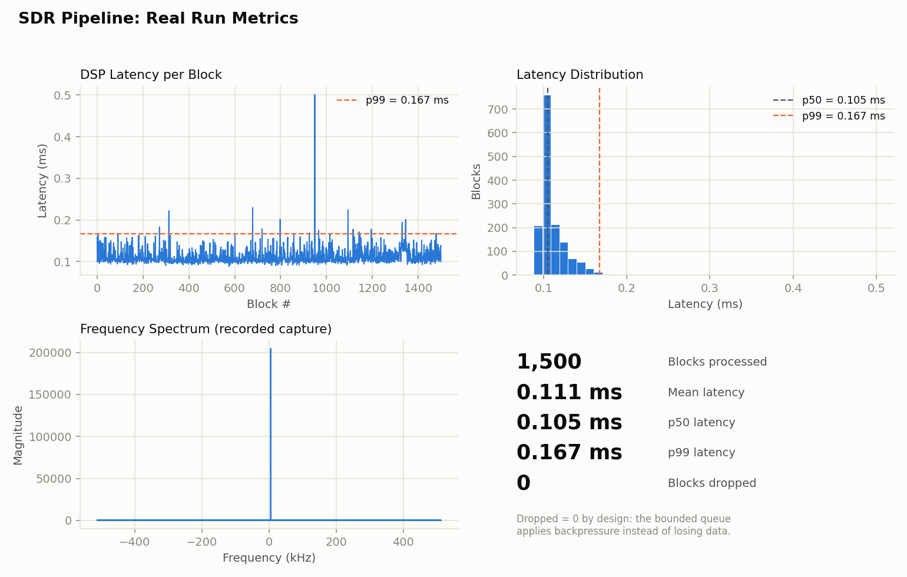
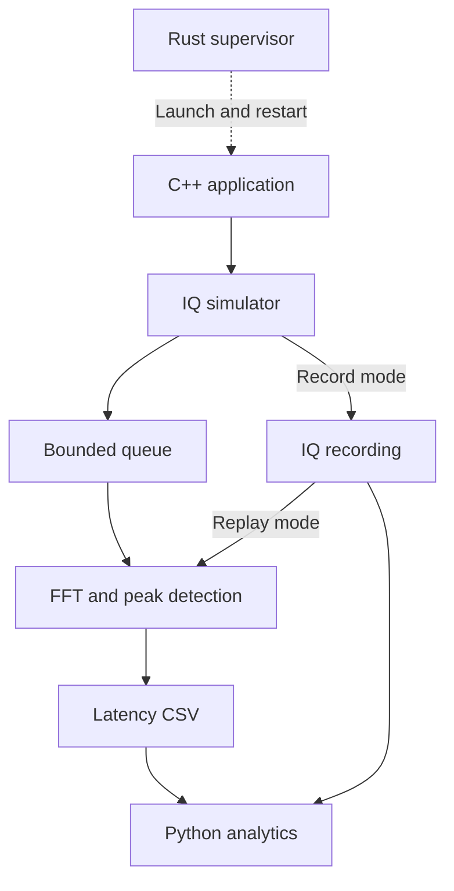

<div align="center">

# SDR & RF Processing Platform

A software-defined radio simulation with a C++20 DSP core, Rust process
supervision, and Python analytics. Explores signal processing, concurrent
buffering, and failure handling without radio hardware.

[](src/)
[](rust_supervisor/)
[](python/)
[](CMakeLists.txt)
[](Dockerfile)
[](LICENSE)

**[Read the technical paper](docs/sdr-technical-paper.pdf)** ·
**[LaTeX source](docs/sdr-technical-paper.tex)**

</div>

## Technical paper

**[Open the report in GitHub's scrollable PDF viewer](docs/sdr-technical-paper.pdf)** ·
[LaTeX source](docs/sdr-technical-paper.tex)


<p align="center">
  
</p>

<p align="center"><sub>Historical dashboard generated from the committed sample artifacts. See measurement scope and implementation status below.</sub></p>

## Overview

The platform models the software data path of an SDR receiver. A producer
generates complex in-phase and quadrature (IQ) samples. A consumer processes
blocks through a radix-2 fast Fourier transform (FFT) and identifies the
strongest frequency bin.

A bounded queue coordinates the threads and applies backpressure when the
consumer falls behind. A Rust supervisor launches the processing application
and exercises restart behavior through randomized process termination.
Python scripts summarize latency measurements and plot recorded samples.

The technical paper documents the architecture, archived measurements,
source findings, and acceptance criteria for numerical correctness,
recording fidelity, queue behavior, and recovery.

## Architecture



Live, record, and replay are separate application modes. Record mode writes
simulated samples directly to a file; replay mode reads a file and processes
its blocks without the live producer-consumer queue.

| Component | Implementation |
|---|---|
| Signal generation | Complex tone with bounded pseudorandom noise |
| Concurrent processing | Producer and consumer threads, mutex, condition variables, bounded queue |
| Frequency analysis | Iterative radix-2 FFT, magnitude spectrum, peak-bin search |
| Instrumentation | Per-block processing latency and CSV output |
| Process supervision | Tokio child-process management, delayed retries, randomized failure injection |
| Offline analysis | NumPy statistics and Matplotlib plots |

## Archived performance

Recalculated from [samples/metrics.csv](samples/metrics.csv), which contains
1,500 observations with contiguous block identifiers from 0 through 1,499.

The intended configuration uses 4,096 samples per block, a nominal sample
rate of 1.024 MS/s, and a 5 kHz tone.

| Metric | Result |
|---|---:|
| Mean processing latency | 0.111014 ms |
| Median processing latency | 0.104865 ms |
| p99 processing latency, interpolated | 0.167423 ms |
| Maximum observed processing latency | 0.501117 ms |
| Peak frequency bin | 20 in all 1,500 rows |
| Nominal frequency-bin spacing | 250 Hz |

Timing covers sample conversion, spectrum computation, and peak search.
It excludes sample generation, queue waiting, queue removal copies, and
CSV or console output. These are processing measurements, not end-to-end
latency or a worst-case execution bound.

The 4 ms nominal block period follows from the configured sample rate.
The producer sleeps after generation and enqueueing, so that configuration
does not establish a sustained wall-clock acquisition rate of 1.024 MS/s.

The CSV does not identify its producing commit or machine configuration.
These historical results have not been reproduced from the current source.

## Implementation status

Source inspection identified several issues that require correction before
a fresh build and record/replay validation:

- Simulator names and namespaces differ between declarations and callers.
  Constructor parameter order also differs.
- IQ fields use `double`, while recording and playback transfer float-sized
  byte sequences without numerical conversion.
- Replay can pass a partial block to an FFT that assumes a power-of-two length.

Delivery and recovery also need additional verification. The live pipeline
does not invoke its dropped-block counter, and the dashboard displays a
fixed zero for dropped blocks. Queue backpressure does not establish lossless
hardware acquisition. Process relaunch does not restore processing state
or detect a child that remains alive but stops making progress.

See the [technical paper](docs/sdr-technical-paper.pdf) for the full analysis
and proposed acceptance tests.

## Build and run

The commands below describe the application workflow. Resolve the source
issues above before using them to establish a new benchmark baseline.

Run from the repository root unless a command explicitly changes directories.

### C++ core

Requires CMake 3.16 or newer and a compiler supporting C++20. The current
simulator header uses a GNU-specific include.

```bash
cmake -S . -B build -DCMAKE_BUILD_TYPE=Release
cmake --build build
ctest --test-dir build --output-on-failure

# Process simulated samples and write per-block measurements.
./build/sdr_platform live metrics.csv

# Record simulated samples, then process the recording.
./build/sdr_platform record capture.iq
./build/sdr_platform replay capture.iq
```

The included FFT test checks the peak bin of a known real-valued tone.
Broader numerical and integration tests are specified in the paper.

### Rust supervisor

The supervisor resolves the C++ executable relative to its working directory,
so run it from `rust_supervisor/`.

```bash
cd rust_supervisor
cargo build --release
./target/release/sdr_supervisor live
```

Randomized failure injection is enabled in the current implementation.
The supervisor may intentionally terminate the child during a run.

### Python analytics

Run from the repository root:

```bash
python3 -m pip install -r python/requirements.txt

# Regenerate the historical dashboard from committed artifacts.
python3 python/generate_report.py samples/metrics.csv samples/capture.iq

# Inspect an IQ recording.
python3 python/analyze_iq.py samples/capture.iq 1024000
```

The IQ plots interpret the file as interleaved float32 values. Plot generation
alone does not verify recording fidelity; the serialization issue above
must be resolved and tested.

### Docker

The repository includes a Docker build definition. Building the container
also depends on correcting the C++ source issues.

```bash
docker build -t sdr_platform .
docker run --rm sdr_platform live
```

## Project structure

```text
src/                    C++ simulator, queue, FFT, metrics, and IQ file handling
tests/                  FFT peak-bin correctness check
rust_supervisor/        Tokio process supervisor and failure injection
python/                 Measurement analysis and plotting
samples/                Archived latency CSV and IQ recording
assets/                 Generated dashboard
docs/                   Technical paper in PDF and LaTeX formats
CMakeLists.txt          C++ build and test configuration
Dockerfile              Container build definition
flake.nix               Nix development environment definition
```

## Development notes

AI assistance (Claude) was used to help develop the test suite (`tests/`)
and the Python analytics and charting scripts (`python/`). The C++ DSP
pipeline and Rust supervisor are original implementation work.

## License

MIT. See [LICENSE](LICENSE).
